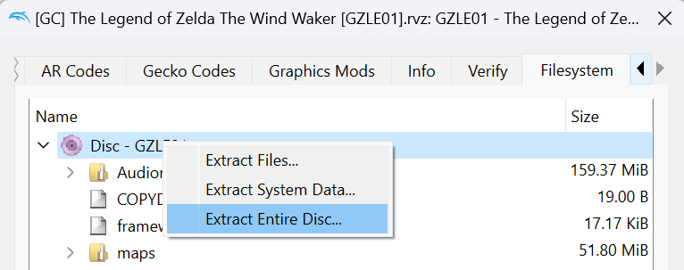

Chibi-Robo: PIA disassembly/decompilation to C++/C
[![Discord Badge]][discord]  
=============

<!--
Replace with your repository's URL.
-->

[Build Status]: https://https://github.com/eavpsp/cbr_decomp/actions/workflows/build.yml/badge.svg
[actions]: https://github.com/eavpsp/cbr_decomp/actions/workflows/build.yml

<!---
Code progress URL:
https://progress.decomp.club/data/[project]/[version]/all/?mode=shield&measure=code
URL encoded then appended to: https://img.shields.io/endpoint?label=Code&url=
-->

[Progress]: https://img.shields.io/endpoint?label=Code&url=https%3A%2F%2Fprogress.decomp.club%2Fdata%2Ftww%2FGZLE01%2Fall%2F%3Fmode%3Dshield%26measure%3Dcode

<!---
DOL progress URL:
https://progress.decomp.club/data/[project]/[version]/dol/?mode=shield&measure=code
URL encoded then appended to: https://img.shields.io/endpoint?label=DOL&url=
-->

[DOL Progress]: https://img.shields.io/endpoint?label=DOL&url=https%3A%2F%2Fprogress.decomp.club%2Fdata%2Ftww%2FGZLE01%2Fdol%2F%3Fmode%3Dshield%26measure%3Dcode

<!--
REL progress URL:
https://progress.decomp.club/data/[project]/[version]/modules/?mode=shield&measure=code
URL encoded then appended to: https://img.shields.io/endpoint?label=RELs&url=
-->

[RELs Progress]: https://img.shields.io/endpoint?label=RELs&url=https%3A%2F%2Fprogress.decomp.club%2Fdata%2Ftww%2FGZLE01%2Fmodules%2F%3Fmode%3Dshield%26measure%3Dcode

<!--
Replace with your Discord server's ID and invite URL.
-->

[Discord Badge]: https://img.shields.io/discord/871177712486736013?color=%237289DA&logo=discord&logoColor=%23FFFFFF
[discord]: https://discord.gg/kxaJjfC2UR

A work-in-progress decompilation of Chibi Robo:PIA.

This repository does **not** contain any game assets or assembly whatsoever. An existing copy of the game is required.

Supported versions:

- `GGTE01`: Rev 0 (USA)

---

## Goal

The goal of this project is to get a PC, Switch, PS4, and PS Vita port of Chibi-Robo PIA.
As you all know, Nintendo has probably buried this game, but developers like myself will make sure that Chibi is rebooted. Thanks again for stopping by.

This is currently a solo project. I work a lot and barely have time to code or be with my cats. Please feel free to support this project:
https://www.buymeacoffee.com/itsemistro

It builds an Matching dol file.

# Dependencies

## Windows:

On Windows, it's **highly recommended** to use native tooling. WSL or msys2 are **not** required.  
When running under WSL, [objdiff](#diffing) is unable to get filesystem notifications for automatic rebuilds.

- Install [Python](https://www.python.org/downloads/) and add it to `%PATH%`.
  - Also available from the [Windows Store](https://apps.microsoft.com/store/detail/python-311/9NRWMJP3717K).
- Download [ninja](https://github.com/ninja-build/ninja/releases) and add it to `%PATH%`.
  - Quick install via pip: `pip install ninja`

## macOS:

- Install [ninja](https://github.com/ninja-build/ninja/wiki/Pre-built-Ninja-packages):
  ```
  brew install ninja
  ```
- Install [wine-crossover](https://github.com/Gcenx/homebrew-wine):
  ```
  brew install --cask --no-quarantine gcenx/wine/wine-crossover
  ```

After OS upgrades, if macOS complains about `Wine Crossover.app` being unverified, you can unquarantine it using:

```sh
sudo xattr -rd com.apple.quarantine '/Applications/Wine Crossover.app'
```

## Linux:

- Install [ninja](https://github.com/ninja-build/ninja/wiki/Pre-built-Ninja-packages).
- For non-x86(\_64) platforms: Install wine from your package manager.
  - For x86(\_64), [WiBo](https://github.com/decompals/WiBo), a minimal 32-bit Windows binary wrapper, will be automatically downloaded and used.

# Building

- Clone the repository:
  ```
  git clone https://github.com/eavpsp/cbr_decomp.git
  ```
- Set up `orig/GAMEID` from your own copy of the game. Either:
  - **From a disc image (one command, recommended).** From the `decomp_dtk_main` folder, run:
    ```
    python tools/setup_orig.py path/to/game.iso
    ```
    It reads a plain 1:1 GameCube image (`.iso`/`.gcm`) or a disc already extracted with Dolphin (a folder with `sys/main.dol` and `files/qp.bin`),
    checks the game ID and the `main.dol` SHA-1, and writes `orig/GGTE01/sys/main.dol` and every module from `qp.bin` to `orig/GGTE01/RELS/rel/`.
    RVZ, GCZ, WIA, WBFS, CISO and NKit images are refused: convert them to ISO first with Dolphin (right-click the game > Convert File...).
    Existing files are kept unless you pass `--force`; see `python tools/setup_orig.py --help` for the other options.
  - **Manually (alternative).** Using [Dolphin Emulator](https://dolphin-emu.org/), extract your game to `orig/GAMEID`.
    
    - To save space, the only necessary files are the following. Any others can be deleted.
      - `sys/main.dol`
      - `files/rels/*.rel` _Rels must be extracted from QP.bin using [U8 Extractor](https://github.com/eavpsp/U8-ARC-Extractor-C-) and put into the orig/GGTE01/RELS/rel directory_
  - Make sure to copy the built \_\_exception.o object from src to the equivalent build directory.
- Configure:
  ```
  python configure.py
  ```
  To use a version other than `GAMEID` (USA), specify it with `--version`.
- Build:
  ```
  ninja
  ```

# Visual Studio Code

If desired, use the recommended Visual Studio Code settings by renaming the `.vscode.example` directory to `.vscode`.

# Diffing

Once the initial build succeeds, an `objdiff.json` should exist in the project root.

Download the latest release from [encounter/objdiff](https://github.com/encounter/objdiff). Under project settings, set `Project directory`. The configuration should be loaded automatically.

Select an object from the left sidebar to begin diffing. Changes to the project will rebuild automatically: changes to source files, headers, `configure.py`, `splits.txt` or `symbols.txt`.


# Decompiling a function

All commands run from the `decomp_dtk_main` folder, after a successful `python configure.py` and `ninja`.

1. **Pick a target.** `python tools/pick_funcs.py` lists functions that are not in a Matching unit yet, small and well-connected ones first
   (see `--help`: `--max-size 0x80`, `--unnamed`, `--leaf`, `--module stage01`, `--callers NAME`, `--callees NAME`...).
2. **Get a first C draft.** `python tools/decomp_func.py <name or 0xADDR>` takes the function from the assembly written by dtk
   (`build/GGTE01/asm`, or `build/GGTE01/<module>/asm` with `--module`), adds the data it reads (jump tables, constants, strings),
   builds a context from the unit's source file (`--unit src/...`, or a default set of SDK headers) and runs m2c on it.
   - `--out FILE` writes the draft to a file, `--calls` lists callers and callees, `--list-unit UNIT` drafts every function of a unit,
     of an asm file (`auto_03_8001364C_text`) or of an address range (`0x80013580-0x80013700`). Arguments after `--` go to m2c
     (e.g. `-- --valid-syntax --stack-structs`).
   - The draft is a starting point: it is neither compiled nor matched. Like the assembly, it is derived from the game, so keep it out of Git
     (the extracted assembly and the context are kept in `build/GGTE01/m2c/`, which is ignored).
3. **Make it match.** Write the code in the unit's source file under `src/`, rebuild with `ninja`, and compare it with [objdiff](#diffing),
   or for every unit at once with `python tools/check_units.py` (a unit marked Matching that does not match is an error).
   Mark the unit `Matching` in `configure.py` once it matches.

**m2c is optional** and not included (GPL-3.0). Install or clone [m2c](https://github.com/matt-kempster/m2c) yourself, then either
pass `--m2c path/to/m2c` (the clone folder or its `m2c.py`), set the `M2C` environment variable, or make the `m2c` Python module importable.
m2c only parses C, so the context of a C++ unit is often refused; the tool then falls back to the default headers, then to no context,
and says so in the header of the draft.

# Reverse-engineering with REA (optional)

[REA](https://github.com/morluto/rea) (Reverse Engineer Anything, npm package `rea-agents`, MIT) drives Ghidra and returns evidence records.
Next to `decomp_func.py` and m2c, it adds Ghidra's decompiled pseudo-C of a function, its cross-references, its call graph and the strings
it uses, from the command line or over MCP (for an agent such as Claude Code). `tools/rea_ghidra.py` runs it on the ELF written by dtk.

**Requirements.** REA only analyses a PowerPC ELF on Linux or macOS (REA docs: "PowerPC ELF through Ghidra", `docs/ghidra-ppc.md`;
on Windows it only takes PE and raw 6502 files, `docs/windows-ghidra-p0.md`). So either:
- [Docker](https://docs.docker.com/get-started/get-docker/) (any OS): the image `tools/rea/Dockerfile` holds JDK 21, Node.js and REA, all versions pinned;
- or, on Linux/macOS, a local REA (`npm install -g rea-agents`, Node.js 22.19 or newer, JDK 21; see REA's `docs/installation.md`) and `--native`.

In both cases you need your own [Ghidra](https://github.com/NationalSecurityAgency/ghidra/releases) 12.1.x (mounted read-only in the container).
The [GameCubeLoader](https://github.com/Cuyler36/Ghidra-GameCube-Loader) extension, installed in `Ghidra/Extensions`, is recommended:
it provides the `PowerPC:BE:32:Gekko_Broadway` language, which decodes paired-single instructions. The tool passes it to REA
(`REA_GHIDRA_LANGUAGE_ID`) when it finds it, else it warns and REA uses its default PowerPC language.

**Commands** (from `decomp_dtk_main`, after `python configure.py` and `ninja`; `--ghidra` can be replaced by `GHIDRA_INSTALL_DIR`):
```
python tools/rea_ghidra.py image
python tools/rea_ghidra.py run --ghidra path/to/ghidra -- analyze {elf} --provider ghidra --json
python tools/rea_ghidra.py run --ghidra path/to/ghidra -- function {elf} ParseStageData__5CGameFiPc --provider ghidra --json
python tools/rea_ghidra.py mcp-config --ghidra path/to/ghidra
```
- `run -- ARGS` runs any REA command (`rea --help`); `{elf}` is replaced by the path of the prepared ELF.
- `mcp` starts REA's MCP server over stdio (REA docs: `docs/mcp-contracts.md`); `mcp-config` prints a ready `mcpServers` entry for `.mcp.json`.
  Inside the container the ELF is `/work/GGTE01.elf`: open it with the `open_binary` tool (`provider_id: "ghidra"`).
- `prepare` (run by the other commands) writes the copy described below; see `python tools/rea_ghidra.py --help`.

**Limits.**
- REA refuses dtk's ELF as is: its `e_flags` holds `EF_PPC_EMB` (PowerPC embedded), which REA's PowerPC ELF path rejects. The tool analyses a copy,
  `build/GGTE01/rea/GGTE01.elf`, with that flag cleared; the build keeps the original.
- Small-data accesses through r2/r13 show up as `unaff_r2 + offset`: the ELF path sets no register value.
- Every CLI call imports the ELF again (about 2 minutes). Use `mcp` to keep one Ghidra session open: only the first request pays the import.
- The DOL itself is not accepted by REA.
- REA's output is derived from the game, like the assembly: keep it out of Git (for example under `build/`).

---

## Test Folder:

Contains tools to inject code into Chibi-Robo via Gecko Codes for debugging and testing

Includes header files and functions that can be changed!
happy modding :)

Usage:
buildCBR.bat nameOfScript.c
After compiling and linking, the gecko code will be added to your clipboard.
Paste the code into dolphin!
